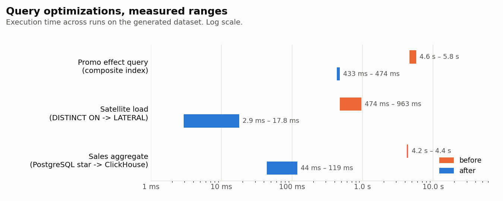
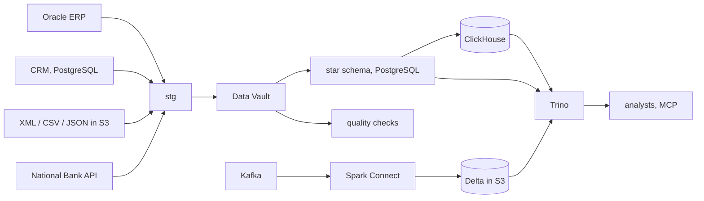
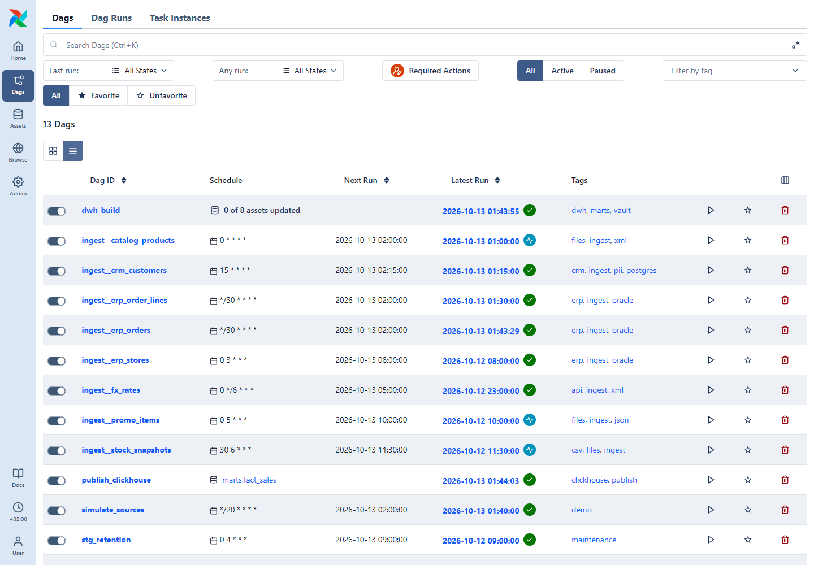
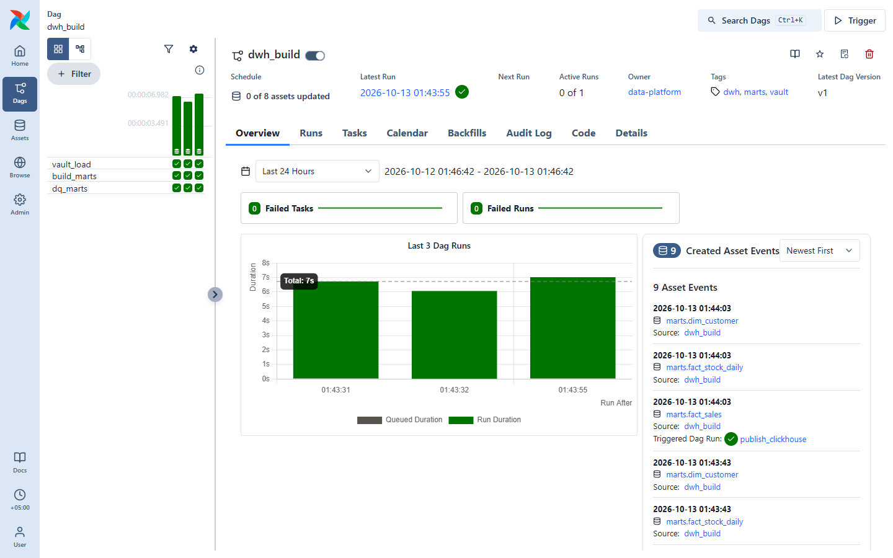
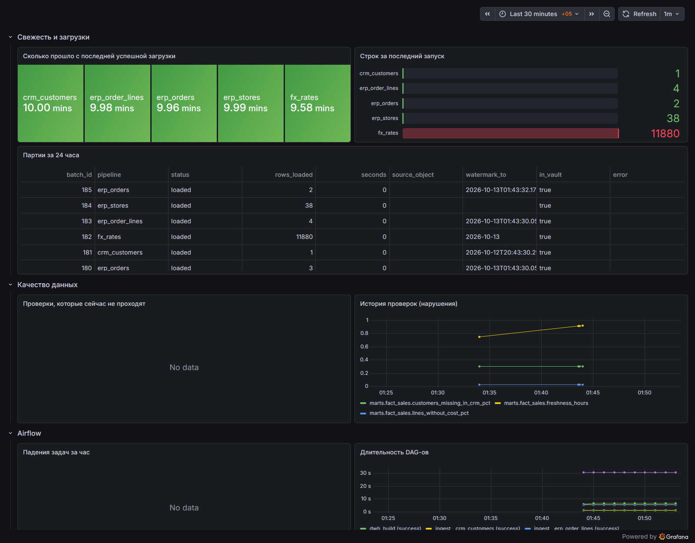
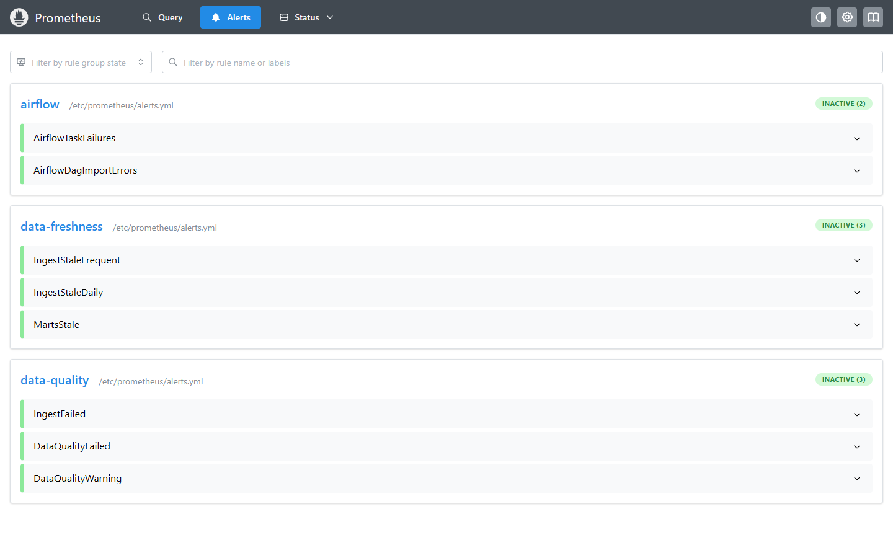
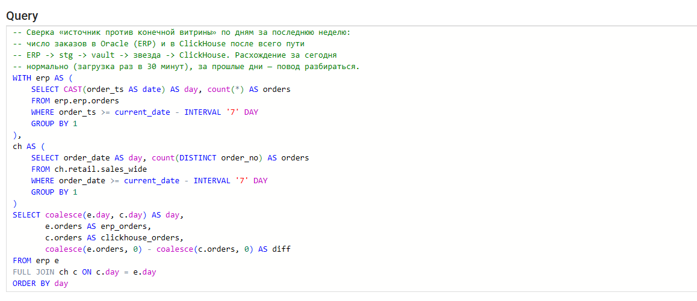
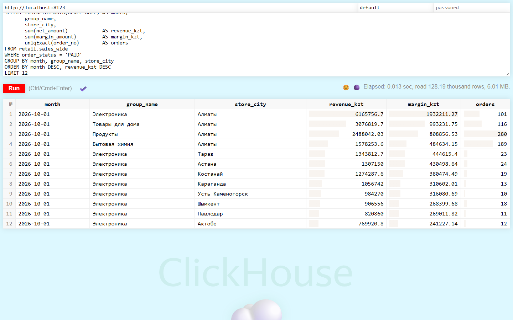
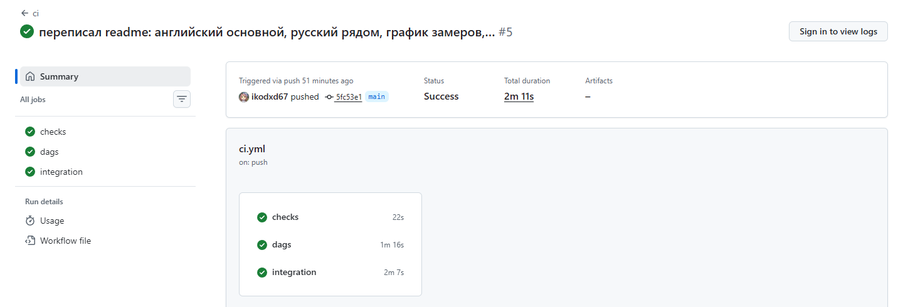

# retail-dwh

[](https://github.com/ikodxd67/retail-dwh/actions/workflows/ci.yml)
[](LICENSE)

**English** · [Русский](README.ru.md)

A data warehouse for a chain of 37 stores and an online shop. Data comes from
five sources of different kinds and is assembled into a Data Vault, from
which star-schema marts are built. Sales are published to ClickHouse, the
site clickstream goes through Kafka and Spark into Delta Lake, and Trino sits
on top of everything. Orchestration is Airflow 3, monitoring is Prometheus and
Grafana. AI agents (Claude Code and similar) work with the warehouse through
its own read-only MCP server.

> **About the data.** The sources are filled by a deterministic generator
> (`src/retail_dwh/generator/`), so all orders, clients and stock are
> **synthetic**. Only the FX rates are real, from the National Bank of
> Kazakhstan API. On the stand: 543k orders, 1.45M order lines, 46.5k clients,
> 2M stock rows, history since January 2025.

## Key results

- **Five source types into one model:** Oracle, PostgreSQL CRM, XML/CSV/JSON
  files in S3, a real XML API and Kafka — each source is one YAML file, and
  a factory builds its Airflow DAG.
- **Data Vault generated from a model:** DDL and load SQL come from
  `models/vault.yml`; the satellite load uses `LATERAL` instead of
  `DISTINCT ON`: **474–963 ms → 2.9–17.8 ms** at this size.
- **Measured query tuning:** a composite covering index took the promo-effect
  query from 4.6–5.8 s to **433–474 ms**; the same sales aggregate takes
  4.2–4.4 s on the PostgreSQL star and **44–119 ms** in ClickHouse.
- **Governance in code:** lineage is computed from SQL (sqlglot), and a test
  checks that personal data never reaches the marts.

<picture>
  <source media="(prefers-color-scheme: dark)" srcset="docs/img/optimizations_dark.png">
  
</picture>

## Architecture



More: [architecture](docs/architecture.md) · [decisions and trade-offs](docs/decisions.md) ·
[measurements](docs/performance.md) · [runbook](docs/runbook.md) (docs are in Russian)

## Screenshots

Taken on the running stand on 2026-10-13. The stand was regenerated from
scratch for this, so it is smaller than the one in [measurements](docs/performance.md):
128k order lines instead of 1.45M. Timings in the screenshots are not
comparable with the measurements. The Grafana dashboard is in Russian.

**Airflow: 13 DAGs.** Eight `ingest__*` DAGs are built by one factory from
the YAML files in `pipelines/`; `dwh_build` and `publish_clickhouse` have no
cron schedule and run on data (Assets).



**Airflow: `dwh_build` started by data, not by the clock.** After an
`ingest__erp_orders` run, all three builds have the type *Asset Triggered*.
On the right are the assets the build produced; the `marts.fact_sales` event
in turn triggered `publish_clickhouse`.



**Grafana: freshness, loads, data quality, Airflow.** Minutes since the last
successful load per source, rows per run, the batch journal, check history
and DAG durations. "No data" in the failing-checks and task-failures panels
means nothing is failing.



**Prometheus: alert rules.** Data freshness is alerted separately from task
failures: a DAG can be green while no new data arrives.



**Trino: one query across two systems.** Orders per day in Oracle (ERP)
against orders in ClickHouse at the end of the whole path
ERP → stg → vault → star → ClickHouse
([`sql/trino/02_reconcile_erp_vs_clickhouse.sql`](sql/trino/02_reconcile_erp_vs_clickhouse.sql)).



The result on the stand: the difference is 0 for every day.

| day | erp_orders | clickhouse_orders | diff |
|---|---|---|---|
| 2026-10-06 | 60 | 60 | 0 |
| 2026-10-07 | 95 | 95 | 0 |
| 2026-10-08 | 68 | 68 | 0 |
| 2026-10-09 | 75 | 75 | 0 |
| 2026-10-10 | 102 | 102 | 0 |
| 2026-10-11 | 96 | 96 | 0 |
| 2026-10-12 | 69 | 69 | 0 |
| 2026-10-13 | 3 | 3 | 0 |

**ClickHouse: the published sales mart.** Revenue, margin and orders by
month × product group × city over the whole history; product and city names
are Russian, as in the source systems.



**CI: lint and unit tests, DAG tests in the Airflow image, integration tests
on live Oracle and PostgreSQL.**



## Running it

Docker (8 GB of memory for Docker Desktop) and Python 3.12.

```bash
python -m venv .venv && .venv/Scripts/activate      # Linux/macOS: source .venv/bin/activate
pip install -e ".[dev,lake,mcp]"
cp .env.example .env

docker compose up -d                                 # Oracle, CRM, DWH, S3
retail-dwh migrate
retail-dwh simulate                                  # history since 2025, a few minutes
retail-dwh ingest && retail-dwh vault && retail-dwh marts && retail-dwh dq
```

The rest is optional, by profile (the whole stack does not fit into 8 GB):

```bash
docker compose --profile airflow up -d      # http://localhost:8080
docker compose --profile lake up -d         # Kafka, Spark :4040, Trino :8085, ClickHouse :8123
docker compose --profile monitoring up -d   # Grafana :3000, Prometheus :9090
```

Tests:

```bash
pytest -m "not integration"   # 43 tests, seconds
pytest -m integration         # against the running stand
```

## What's inside

| | |
|---|---|
| **Sources** | Oracle Free 23ai (ERP: orders, lines, stores), PostgreSQL (CRM with client changes), supplier and warehouse files in S3: catalog in **XML**, stock in **CSV.gz** (`;` separator, decimal comma, BOM), promos in **JSON**; the real **XML API of the National Bank of Kazakhstan**; site event stream in **Kafka** |
| **Loading** | One source is one YAML (`pipelines/`), a factory builds the DAG from it. Watermark increments with overlap, atomic batches, quarantine for batches that fail checks, a file registry by ETag |
| **DWH** | **Data Vault 2.0**: DDL and load SQL are generated from `models/vault.yml`. Marts are a **star** with a **snowflake** for products, **SCD2** on clients, a partitioned fact, MERGE |
| **SQL** | CTEs, window functions (LAG, NTILE, running totals), LATERAL, MERGE, self-joins, as-of joins over intervals. Analytics in [`sql/analytics/`](sql/analytics) |
| **Airflow 3** | DAG factory from YAML, custom `IngestOperator`, `LandingFilesSensor` (reschedule), `DataQualityOperator`; data-aware scheduling with Assets |
| **Streaming** | Kafka → Spark 3.5 via **Spark Connect** → **Delta** (bronze, per-event dedup within a watermark, quarantine for broken messages) → sessions (silver) → funnel in ClickHouse |
| **ClickHouse** | monthly publishing: ClickHouse reads PostgreSQL itself through `postgresql()`, a month is swapped atomically with `REPLACE PARTITION` and a row-count check |
| **Trino** | one SQL over Oracle, PostgreSQL, ClickHouse and Delta ([`sql/trino/`](sql/trino)) |
| **Data quality** | checks on stg batches and marts: reconciliation with the vault to the tenge, referential integrity, SCD2 continuity, freshness |
| **Monitoring** | Airflow metrics (StatsD), load and check metrics (Pushgateway), data freshness alerts, a Grafana dashboard |
| **Governance** | catalog with owners and PII classes, **lineage computed from code** (sqlglot); a test that personal data does not reach the marts |
| **AI agents** | MCP server: catalog search, lineage, pipeline state, DQ, read-only SQL (enforced by Trino permissions, not only by a parser). Skills for common tasks: add a source, triage a failed check |
| **CI** | GitHub Actions: linter and unit tests; DAG tests in the same Airflow image; integration tests on live Oracle and PostgreSQL |

## Measurements

Stand: Docker Desktop on Windows, 8 GB VM, PostgreSQL 16, ClickHouse 24.8;
each query run three times, the range is shown. Details —
[performance.md](docs/performance.md).

| | Before | After |
|---|---|---|
| Promo-effect query: index `(product_sk)` → `(product_sk, order_ts) INCLUDE (...)` | 4 611 – 5 751 ms | 433 – 474 ms |
| Satellite load: `DISTINCT ON` → `LEFT JOIN LATERAL` | 474 – 963 ms | 2.9 – 17.8 ms |
| Sales aggregate: PostgreSQL star → ClickHouse `sales_wide` | 4 242 – 4 442 ms, 496 MB | 44 – 119 ms, 58 MB compressed |

Full build from scratch: stg from Oracle 3 s (orders) and 9 s (lines), 45
CSV.gz stock files 23 s, raw vault 128 s, marts 156 s, publishing 21 months
to ClickHouse ~12 s.

## Layout

```
pipelines/          one YAML per source -> DAG ingest__<name>
models/vault.yml    Data Vault model (DDL and loading come from it)
sql/
  extract/          source queries
  dwh/              warehouse migrations
  marts/            mart build, step by step
  analytics/        analytical queries
  trino/            federated queries
catalog/            data catalog and mart checks
dags/               Airflow DAGs
spark/jobs/         Spark: Kafka -> Delta -> sessions
src/retail_dwh/     code: loading, vault, marts, DQ, publishing, catalog, MCP
docker/             service images and configs
.claude/skills/     instructions for AI agents
```

## What is not here

No Greenplum or Vertica: PostgreSQL and ClickHouse instead, reasons in
[decisions.md](docs/decisions.md). No Kubernetes or Helm: the stand runs on
one machine in docker compose. Instead of AWS S3 — SeaweedFS with the same API
(MinIO was used, but its images became unavailable in 2026 — see
[decisions.md](docs/decisions.md)). No Alertmanager: alerts are visible in
Prometheus but not sent anywhere.

## License

[MIT](LICENSE)
