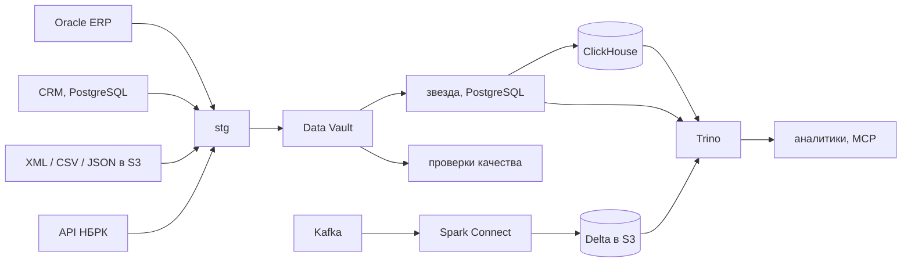

# retail-dwh

[](https://github.com/ikodxd67/retail-dwh/actions/workflows/ci.yml)
[](LICENSE)

[English](README.md) · **Русский**

Хранилище данных для сети из 37 магазинов и интернет-магазина. Данные
приходят из пяти источников разной природы и собираются в Data Vault, из
которого строятся звёздные витрины. Продажи публикуются в ClickHouse,
кликстрим сайта идёт через Kafka и Spark в Delta Lake, а поверх всего
работает Trino. Оркестрация — Airflow 3, мониторинг — Prometheus и Grafana.
Агенты (Claude Code и подобные) работают с хранилищем через собственный
MCP-сервер только на чтение.

> **Про данные.** Источники наполняет детерминированный генератор
> (`src/retail_dwh/generator/`), так что заказы, клиенты и остатки
> **синтетические**. Настоящие только курсы валют — с API НБРК. На стенде:
> 543 тыс. заказов, 1,45 млн строк заказов, 46,5 тыс. клиентов, 2 млн строк
> остатков, история с января 2025.

## Главное

- **Пять видов источников в одну модель:** Oracle, CRM на PostgreSQL, файлы
  XML/CSV/JSON в S3, настоящее XML API и Kafka. Источник описывается одним
  YAML, DAG для него строит фабрика.
- **Data Vault генерируется из модели:** DDL и SQL загрузки получаются из
  `models/vault.yml`; загрузка сателлитов через `LATERAL` вместо
  `DISTINCT ON`: **474–963 мс → 2,9–17,8 мс** на этом объёме.
- **Оптимизация с замерами:** составной покрывающий индекс ускорил запрос
  эффекта промо с 4,6–5,8 с до **433–474 мс**; один и тот же агрегат продаж
  считается 4,2–4,4 с на звезде в PostgreSQL и **44–119 мс** в ClickHouse.
- **Governance в коде:** lineage вычисляется из SQL (sqlglot), тест проверяет,
  что персональные данные не доходят до витрин.

<picture>
  <source media="(prefers-color-scheme: dark)" srcset="docs/img/optimizations_dark.png">
  
</picture>

## Архитектура



Подробнее: [архитектура](docs/architecture.md) · [решения и компромиссы](docs/decisions.md) ·
[замеры](docs/performance.md) · [runbook](docs/runbook.md)

## Скриншоты

Сняты на работающем стенде 13.10.2026. Для этого стенд собран заново, и он
меньше того, на котором делались [замеры](docs/performance.md): 128 тыс. строк
заказов вместо 1,45 млн. Время на скриншотах с замерами не сравнивается.

**Airflow: 13 DAG-ов.** Восемь `ingest__*` строит одна фабрика из YAML-файлов
в `pipelines/`; у `dwh_build` и `publish_clickhouse` нет cron-расписания,
они запускаются по данным (Assets).


**Airflow: `dwh_build` запускается по данным, а не по часам.** После запуска
`ingest__erp_orders` все три сборки имеют тип *Asset Triggered*. Справа
события, которые создала сборка; событие `marts.fact_sales` в свою очередь
запустило `publish_clickhouse`.


**Grafana: свежесть, загрузки, качество данных, Airflow.** Сколько минут
прошло с последней успешной загрузки каждого источника, строки за запуск,
журнал партий, история проверок и длительность DAG-ов. «No data» в панелях
непройденных проверок и падений задач значит, что ничего не падает.


**Prometheus: правила алертов.** Свежесть данных отслеживается отдельно от
падений задач: DAG может быть зелёным, а новых данных при этом нет.


**Trino: один запрос через две системы.** Число заказов по дням в Oracle
(ERP) против числа заказов в ClickHouse в конце всего пути
ERP → stg → vault → звезда → ClickHouse
([`sql/trino/02_reconcile_erp_vs_clickhouse.sql`](sql/trino/02_reconcile_erp_vs_clickhouse.sql)).


Результат на стенде: расхождение 0 за каждый день.

| day | erp_orders | clickhouse_orders | diff |
|---|---|---|---|
| 2026-10-06 | 60 | 60 | 0 |
| 2026-10-07 | 95 | 95 | 0 |
| 2026-10-08 | 68 | 68 | 0 |
| 2026-10-09 | 75 | 75 | 0 |
| 2026-10-10 | 102 | 102 | 0 |
| 2026-10-11 | 96 | 96 | 0 |
| 2026-10-12 | 69 | 69 | 0 |
| 2026-10-13 | 3 | 3 | 0 |

**ClickHouse: опубликованная витрина продаж.** Выручка, маржа и заказы по
месяцам × группам товаров × городам за всю историю.


**CI: линтер и юнит-тесты, тесты DAG-ов в образе Airflow, интеграционные тесты
на живых Oracle и PostgreSQL.**


## Запуск

Нужен Docker (память для Docker Desktop — 8 ГБ) и Python 3.12.

```bash
python -m venv .venv && .venv/Scripts/activate      # Linux/macOS: source .venv/bin/activate
pip install -e ".[dev,lake,mcp]"
cp .env.example .env

docker compose up -d                                 # Oracle, CRM, DWH, S3
retail-dwh migrate
retail-dwh simulate                                  # история с 2025 года, несколько минут
retail-dwh ingest && retail-dwh vault && retail-dwh marts && retail-dwh dq
```

Дальше по желанию, профилями (целиком стек в 8 ГБ не помещается):

```bash
docker compose --profile airflow up -d      # http://localhost:8080
docker compose --profile lake up -d         # Kafka, Spark :4040, Trino :8085, ClickHouse :8123
docker compose --profile monitoring up -d   # Grafana :3000, Prometheus :9090
```

Тесты:

```bash
pytest -m "not integration"   # 43 теста, секунды
pytest -m integration         # против поднятого стенда
```

## Что внутри

| | |
|---|---|
| **Источники** | Oracle Free 23ai (ERP: заказы, строки, магазины), PostgreSQL (CRM с изменениями клиентов), файлы поставщика и склада в S3: каталог в **XML**, остатки в **CSV.gz** (разделитель `;`, запятая в дробях, BOM), промо в **JSON**; настоящее **XML API Нацбанка РК**; поток событий сайта в **Kafka** |
| **Загрузка** | Один источник описывается одним YAML (`pipelines/`), по нему фабрика строит DAG. Инкремент по водяному знаку с перекрытием, атомарные партии, карантин партий, не прошедших проверку, реестр файлов по ETag |
| **DWH** | **Data Vault 2.0**: DDL и SQL загрузки генерируются из `models/vault.yml`. Витрины — **звезда** со **снежинкой** по товарам, **SCD2** по клиентам, секционированный факт, MERGE |
| **SQL** | CTE, оконные функции (LAG, NTILE, накопительные суммы), LATERAL, MERGE, self-join, as-of соединения по интервалам. Аналитика в [`sql/analytics/`](sql/analytics) |
| **Airflow 3** | фабрика DAG из YAML, свои `IngestOperator`, `LandingFilesSensor` (reschedule), `DataQualityOperator`; расписание по Asset-ам (data-aware) |
| **Стриминг** | Kafka → Spark 3.5 через **Spark Connect** → **Delta** (bronze, дедупликация по событию в пределах водяного знака, карантин битых сообщений) → сессии (silver) → воронка в ClickHouse |
| **ClickHouse** | публикация помесячно: ClickHouse сам читает PostgreSQL через `postgresql()`, месяц подменяется атомарно `REPLACE PARTITION` со сверкой числа строк |
| **Trino** | один SQL поверх Oracle, PostgreSQL, ClickHouse и Delta ([`sql/trino/`](sql/trino)) |
| **Качество данных** | проверки партий stg и витрин: сверка с vault до тенге, ссылочная целостность, непрерывность SCD2, свежесть |
| **Мониторинг** | метрики Airflow (StatsD), метрики загрузок и проверок (Pushgateway), алерты о свежести данных, дашборд Grafana |
| **Governance** | каталог с владельцами и классами PII, **lineage, вычисленный из кода** (sqlglot); тест, что персональные данные не доходят до витрин |
| **AI-агенты** | MCP-сервер: поиск по каталогу, lineage, состояние пайплайнов, DQ, SQL только на чтение (права в Trino, а не только парсер). Skills для типовых задач: подключить источник, разобрать упавшую проверку |
| **CI** | GitHub Actions: линтер и юнит-тесты; тесты DAG-ов в том же образе Airflow; интеграционные тесты на живых Oracle и PostgreSQL |

## Замеры

Стенд: Docker Desktop под Windows, VM с 8 ГБ, PostgreSQL 16, ClickHouse 24.8;
каждый запрос три раза подряд, указан разброс. Подробно —
[performance.md](docs/performance.md).

| | До | После |
|---|---|---|
| Эффект промо: индекс `(product_sk)` → `(product_sk, order_ts) INCLUDE (...)` | 4 611 – 5 751 мс | 433 – 474 мс |
| Загрузка сателлитов: `DISTINCT ON` → `LEFT JOIN LATERAL` | 474 – 963 мс | 2,9 – 17,8 мс |
| Агрегат продаж: звезда в PostgreSQL → `sales_wide` в ClickHouse | 4 242 – 4 442 мс, 496 МБ | 44 – 119 мс, 58 МБ сжато |

Полная сборка с нуля: stg из Oracle 3 с (заказы) и 9 с (строки), 45 файлов
остатков CSV.gz 23 с, raw vault 128 с, витрины 156 с, публикация 21 месяца в
ClickHouse ~12 с.

## Структура

```
pipelines/          по YAML на источник -> DAG ingest__<имя>
models/vault.yml    модель Data Vault (из неё DDL и загрузка)
sql/
  extract/          запросы к источникам
  dwh/              миграции хранилища
  marts/            сборка витрин по шагам
  analytics/        аналитические запросы
  trino/            федеративные запросы
catalog/            каталог данных и проверки витрин
dags/               DAG-и Airflow
spark/jobs/         Spark: Kafka -> Delta -> сессии
src/retail_dwh/     код: загрузка, vault, витрины, DQ, публикация, каталог, MCP
docker/             образы и конфиги сервисов
.claude/skills/     инструкции для AI-агентов
```

## Чего здесь нет

Здесь нет Greenplum и Vertica: вместо них PostgreSQL и ClickHouse, причины в
[decisions.md](docs/decisions.md). Нет Kubernetes и Helm: стенд работает на одной
машине в docker compose. Вместо AWS S3 — SeaweedFS с тем же API (MinIO был, но в 2026 его образы
перестали быть доступны — см. [decisions.md](docs/decisions.md)). Нет
Alertmanager: алерты видны в Prometheus, но никуда не отправляются.

## Лицензия

[MIT](LICENSE)
