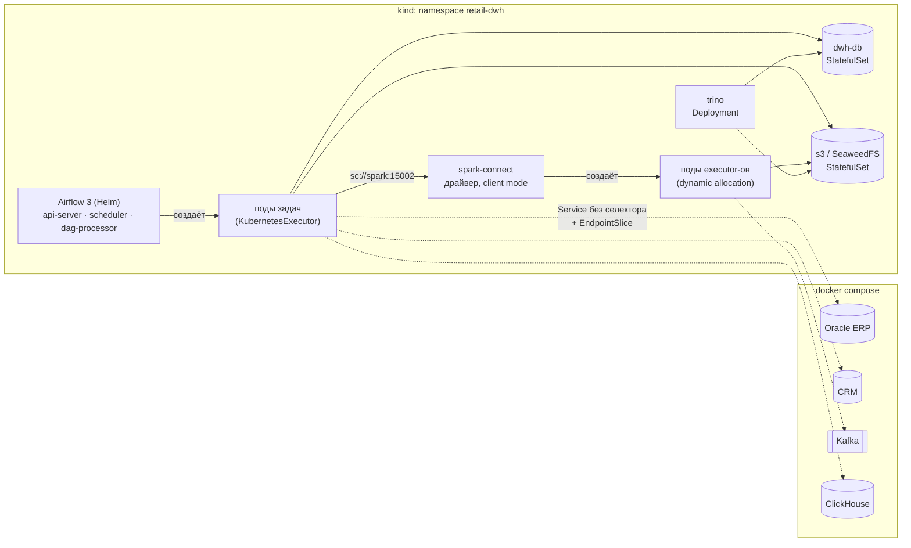
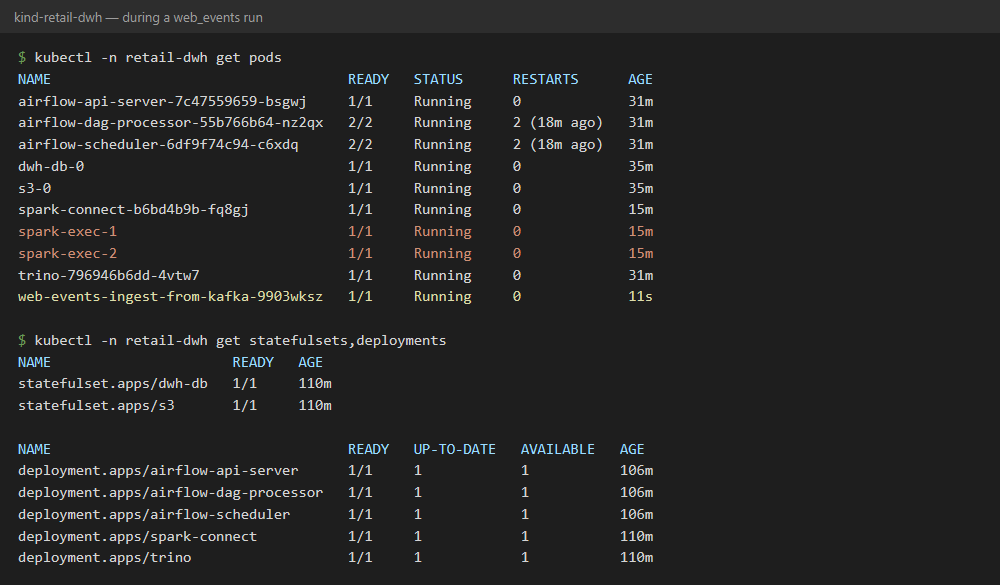
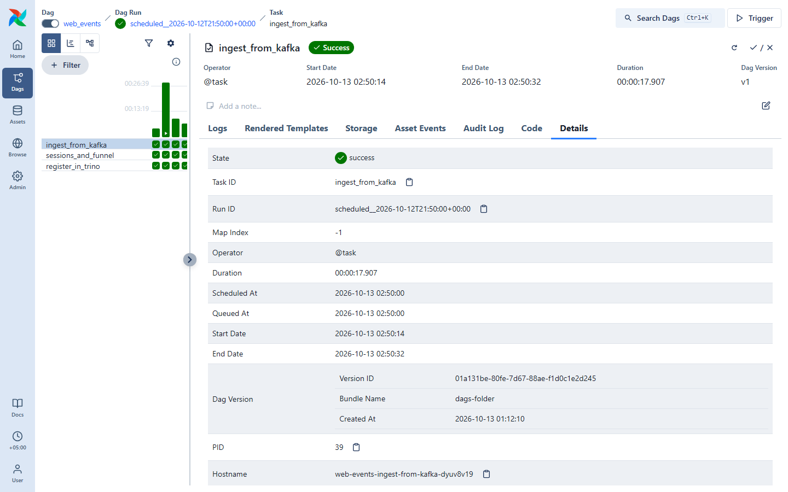
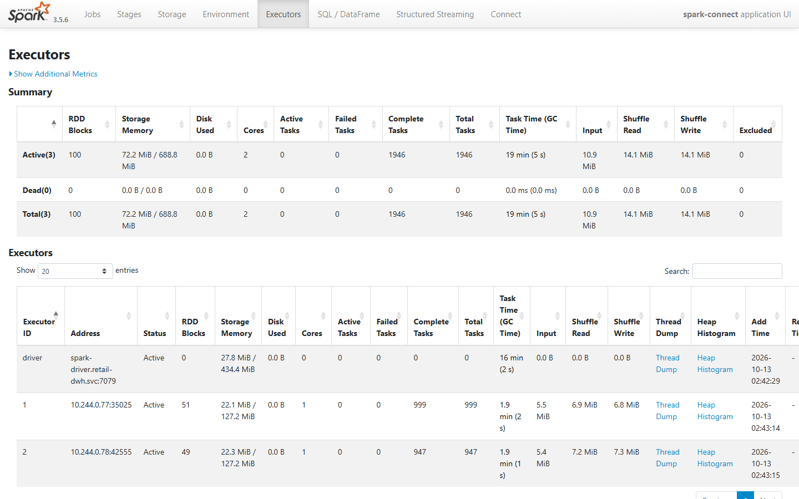

# Стенд в Kubernetes (kind)

Основной способ запуска — docker compose. Здесь второй: ядро хранилища в
локальном кластере kind. Цель — показать, как тот же проект живёт в
Kubernetes, и отработать это руками. Это не прод: кластер из одного узла
на ноутбуке ничего не добавляет к надёжности (см. «Чем это не прод»).

## Что где работает



| Сервис | Где | Объект Kubernetes | Почему так |
|---|---|---|---|
| dwh-db (PostgreSQL) | кластер | StatefulSet + headless Service + PVC | постоянное имя пода и свой том |
| s3 (SeaweedFS) | кластер | StatefulSet + PVC | то же, хранилище с состоянием |
| Airflow | кластер | Helm-чарт `apache-airflow/airflow` 1.22.0 | KubernetesExecutor: задача = под |
| Spark | кластер | Deployment (драйвер) + поды executor-ов | executor-ы по требованию |
| Trino | кластер | Deployment + ConfigMap | без состояния |
| Oracle, CRM, Kafka, ClickHouse | compose | Service без селектора + EndpointSlice | чужие системы вне нашего кластера |

Имена Service совпадают с именами сервисов в compose (`dwh-db`, `s3`,
`spark`, `trino`, `oracle`, `kafka` …). Поэтому переменные `RETAIL_*`, файлы
каталогов Trino и код задач одинаковые в обоих режимах.

## Запуск

Нужны Docker, kind, kubectl и helm. Памяти Docker нужно не меньше 8 ГБ:
узел kind со всем внутри занимает 4–6 ГБ.

```bash
docker compose up -d oracle crm-db        # источники
k8s/scripts/up.sh                         # кластер, образ, манифесты, Airflow
docker compose --profile lake up -d kafka event-producer clickhouse
k8s/scripts/link-compose.sh               # после запуска новых сервисов compose
```

`up.sh` можно запускать повторно: он пересоберёт образ и обновит всё, что
поменялось. `SKIP_BUILD=1` пропускает сборку.

Интерфейсы — через `port-forward` (кластер не занимает порты хоста):

```bash
kubectl -n retail-dwh port-forward svc/airflow-api-server 8080:8080
```

```bash
kubectl -n retail-dwh port-forward svc/spark 4040:4040
```

Удалить всё (тома кластера тоже):

```bash
k8s/scripts/down.sh
```

## Как это устроено

**Код в образе.** При KubernetesExecutor каждая задача стартует в новом
поде, и папку с ноутбука туда не смонтировать. Поэтому у
`docker/airflow/Dockerfile` две цели: `base` для compose (код монтируется)
и `k8s` (код и DAG-и скопированы внутрь). В kind образ загружается командой
`kind load docker-image`, а `pullPolicy: Never` запрещает искать его в
реестре.

**Логи задач в S3.** Под задачи удаляется после работы вместе с файлами
логов, поэтому `remote_logging` пишет их в бакет `airflow-logs`, а
api-server читает оттуда.

**Spark.** Под `spark-connect` — это драйвер в client mode (драйвер там,
где запущен `spark-submit`). Executor-ы он заказывает у API Kubernetes
сам, под ServiceAccount `spark` с Role только на свой namespace. Включён
dynamic allocation: без нагрузки executor-ов ноль, при запросе
поднимается до двух, после простоя они удаляются. Задачи Airflow ходят
на `sc://spark:15002`, как и в compose: код не знает, где Spark.

**Внешние сервисы.** `link-compose.sh` подключает контейнер из compose к
docker-сети `kind` и создаёт Service без селектора с EndpointSlice на IP
контейнера. Под резолвит `kafka` в этот Service, Service ведёт на
контейнер. Так же в кластерах подключают управляемые базы и сервисы
соседних команд.

**Подготовка.** `k8s/jobs/bootstrap.yaml` — Job с миграциями DWH и
бакетами. Job, а не под: Kubernetes перезапускает его, пока он не
завершится успешно (например, пока база ещё поднимается).

## Грабли, на которые я наступил

- **Драйвер Spark не стартовал: `UnresolvedAddressException`.** Executor-ы
  находят драйвер по headless-сервису `spark-driver`. Такой сервис отдаёт в
  DNS только готовые поды, а под не станет готовым, пока драйвер не
  запустился. Драйвер пытался слушать на этом имени и падал. Починил двумя
  настройками: `spark.driver.bindAddress=0.0.0.0` (слушать на всех
  адресах) и `publishNotReadyAddresses: true` у сервиса.
- **Executor-ы не удалялись после простоя.** С
  `shuffleTracking.enabled` executor, у которого есть shuffle-файлы,
  держится до `shuffleTracking.timeout`, а по умолчанию тот бесконечный.
  Два «пустых» executor-а занимали ~1,5 ГБ, пока узел не начал задыхаться
  (перезапустились api-server и Trino). Поставил таймаут 120 с.
- **`helm upgrade` падал с `field is immutable`.** Миграцию Airflow
  запускаю обычным Job, а не helm-хуком (с хуком `--wait` ждёт подов, а
  поды ждут миграции). Но spec у Job менять нельзя: любое изменение
  values ломало upgrade. `up.sh` удаляет старый Job перед upgrade.
- **Executor-ы убивал OOM, а за ними падал драйвер.** Лимит пода
  executor-а = `spark.executor.memory` + overhead (по умолчанию 384m).
  Delta, Parquet и клиент Kafka держат память вне хипа, и java дорастала
  до ~905 МБ при лимите 896 Mi (видно в `dmesg` узла). После 4 отказов
  executor-ов Spark останавливает приложение целиком (выход с кодом 11),
  а для Connect-сервера это весь Spark. Поднял overhead до 512m и считаю
  отказы только за последние 10 минут (`failuresValidityInterval`).
- **Kubernetes перезапускал здоровую базу.** У проб `timeoutSeconds` по
  умолчанию 1 секунда. Когда узлу не хватало памяти, `pg_isready` не
  успевал ответить, liveness-проба считала Postgres зависшим, и
  Kubernetes его перезапускал, а за ним падал Airflow (метаданные в той же
  базе). Поставил пробам таймауты 5–10 с.
- **Таблицы озера не регистрировались в Trino, а DAG был зелёным.** Если в
  `rules.json` нет правил для процедур, Trino разрешает только
  `system.builtin`, и `register_table` запрещён всем — в compose тоже.
  Задача ловила исключение как «таблицы ещё нет» и завершалась успехом.
  Добавил правило для пользователя `retail-dwh`, ошибку доступа больше не
  глотаю, тест `tests/test_trino_rules.py` держит правила.
- **Kustomize не видит файлы из `docker/`.** По умолчанию он не выходит
  за свою папку. Чтобы не держать вторые копии конфигов, сборка идёт с
  `--load-restrictor LoadRestrictionsNone`.
- **Проба S3.** Без подписи S3 отвечает 403, а `httpGet`-проба считает 403
  провалом. Проверяю просто открытый порт (`tcpSocket`).

## Проверено (13.10.2026, Docker 8 ГБ)

Памяти 8 ГБ хватает впритык: на время проверки кликстрима я ставил на
паузу DAG-и загрузки и останавливал Oracle и CRM.


- 7 DAG-ов загрузки и 3 прогона `dwh_build` (запущены по Asset-ам)
  прошли в подах KubernetesExecutor; в `marts.fact_sales` 128 186 строк
  синтетических продаж.
- Логи задач лежат в `s3://airflow-logs/logs/…`.
- Spark: два пода executor-ов поднялись по запросу, записали и прочитали
  Delta-таблицу на 2 млн строк в S3 кластера, через ~4 минуты после
  простоя удалились.
- Trino в кластере читает `dwh.marts.fact_sales`; пользователю
  `mcp-agent` каталог `erp` закрыт, как и в compose.
- `web_events` целиком: Kafka (compose) → Spark на executor-ах в кластере
  → Delta в S3 кластера (42 192 события, 8 333 сессии) → воронка в
  ClickHouse (compose), сессий столько же → таблицы зарегистрированы в
  Trino. Новых OOM за прогон нет.
- Узел kind останавливали и запускали заново (`docker stop/start`): все
  поды поднялись сами, данные в томах на месте.
- Повторный `up.sh` на живом кластере (пересборка образа, upgrade чарта)
  проходит без ручных шагов.

## Скриншоты

Поды во время прогона `web_events`: задача Airflow — отдельный под,
`spark-exec-1/2` — executor-ы, заказанные драйвером.



Задача Airflow: *Hostname* — имя пода, в котором она выполнялась.



Spark UI: драйвер за headless-сервисом, executor-ы с IP подов (те же
10.244.0.77 и .78, что у `spark-exec-1/2`).



## Чем это не прод

- Один узел: упал узел — упало всё. В проде — управляемый кластер (EKS,
  GKE, Yandex Managed Kubernetes) с несколькими узлами.
- База в кластере. Так делают редко: обновления, бэкапы и восстановление
  проще у управляемой базы (RDS, Cloud SQL) или у оператора вроде
  CloudNativePG. Здесь dwh-db в StatefulSet, чтобы разобраться, как
  устроены тома.
- Пароли лежат в git (`secretGenerator`), те же, что в compose. В проде
  Secret создавал бы External Secrets Operator из Vault.
- Нет Ingress, TLS, NetworkPolicy и мониторинга кластера.
